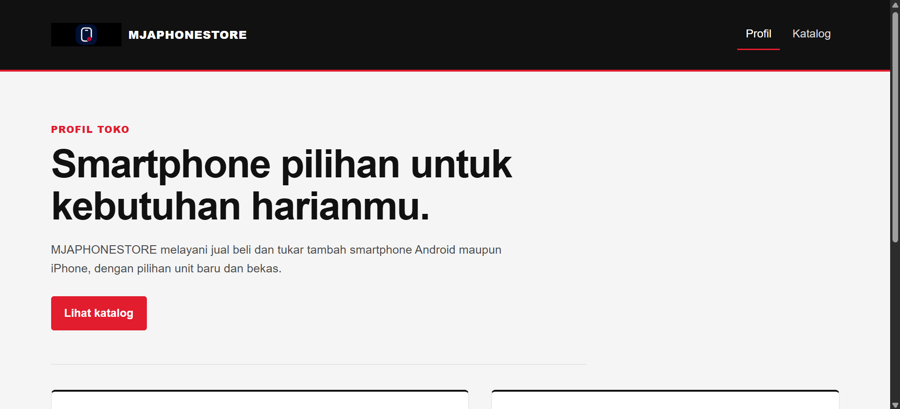
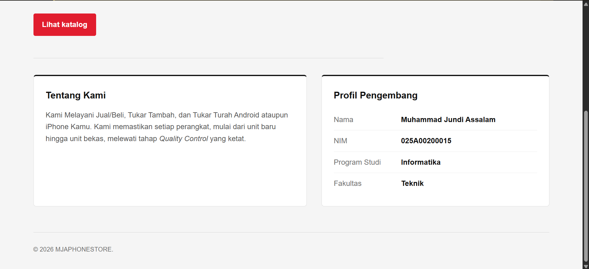
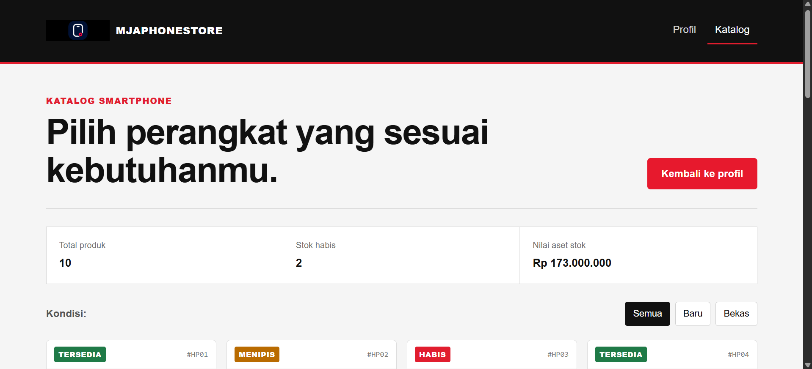
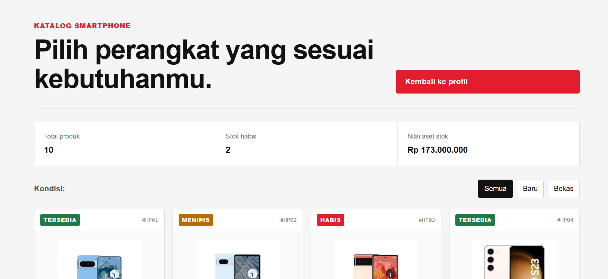
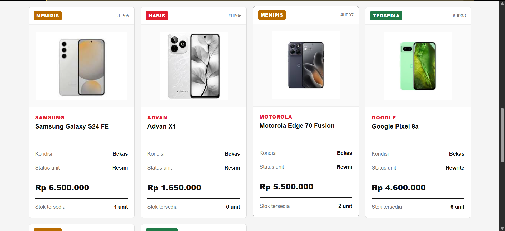
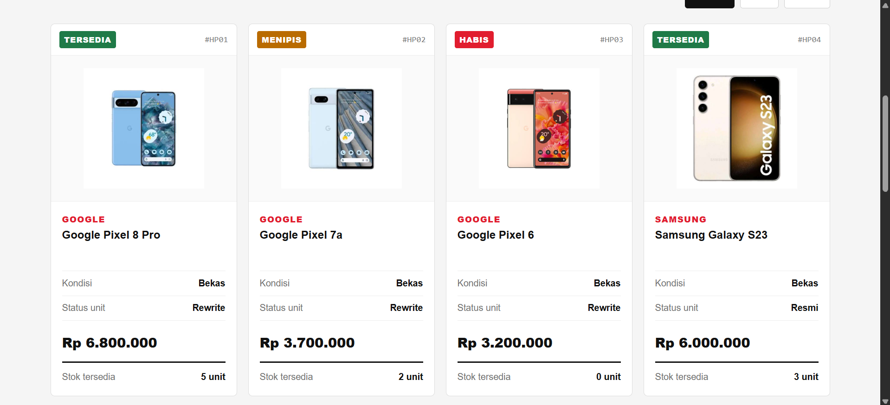
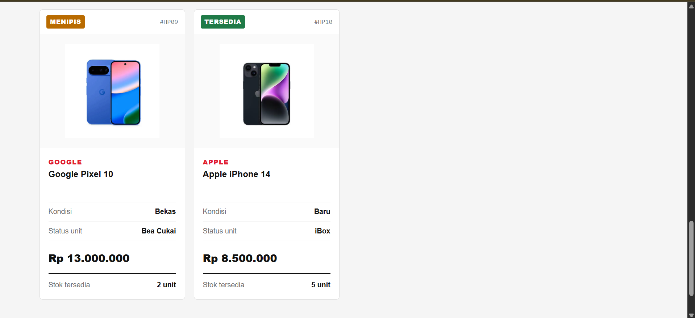

MJAPHONESTORE - Katalog Web
1. Identitas
- Nama: Muhammad Jundi Assalam
- NIM: 025A00200015
- Mata Kuliah: Pemrograman Web

2. Deskripsi Singkat
MJAPHONESTORE adalah website profil dan katalog smartphone sederhana berbasis PHP. Website menampilkan data smartphone baru maupun bekas dari array PHP, lengkap dengan harga, kondisi, status unit, stok, filter kondisi, serta ringkasan nilai aset stok.

3. Cara Menjalankan di Localhost:

1. Pastikan XAMPP atau Laragon sudah terpasang dan Apache berjalan.
2. Simpan atau clone folder proyek ke htdocs pada XAMPP atau www pada Laragon.
3. Pastikan gambar produk berada di folder assets/ sesuai nama file yang ditulis pada data.php.
4. Buka browser dan akses http://localhost/uts-pemweb-025a00200015/index.php.

4. Daftar Fitur beserta File dan Fungsi
- Halaman profil toko: ditangani oleh index.php dan ditata melalui style.css.
- Katalog produk dinamis: ditangani oleh katalog.php, menggunakan data $daftarProduk dari data.php dan dirender dengan foreach.
- Filter kondisi produk: pilihan Semua, Baru, dan Bekas pada katalog.php diproses oleh fungsi filterKondisi() pada functions.php.
- Status stok: fungsi statusStok() menentukan label Habis, Menipis, atau Tersedia berdasarkan jumlah stok.
- Warna status stok: fungsi kelasBadge() menentukan class CSS sesuai status stok.
- Ringkasan nilai stok: fungsi hitungNilaiStok() menghitung total nilai seluruh stok dengan mengalikan harga dan jumlah stok.
- Format harga: fungsi formatRupiah() mengubah angka menjadi format Rupiah.
- Keamanan output: fungsi e() membungkus htmlspecialchars() sebelum data teks dicetak ke HTML.

5. Daftar Fungsi Array Bawaan yang Dipakai
- in_array(): memvalidasi nilai filter kondisi dari query string agar hanya menerima nilai yang tersedia pada $daftarKondisi.
- array_filter(): menyaring produk berdasarkan kondisi dan menghitung produk yang stoknya habis.
- count(): menghitung total produk, jumlah produk hasil filter, dan jumlah produk yang stoknya habis.

6. Tangkapan Layar

Halaman Profil Utama

Halaman Katalog Smartphone

7. Sumber Referensi dan Catatan Pemakaian AI
- Sumber Referensi: dokumentasi resmi PHP (php.net), MDN Web Docs, dan materi perkuliahan Pemrograman Web.
- Catatan Pemakaian AI: AI digunakan sebagai bantuan untuk mengecek struktur kode, memperbaiki tata letak CSS, dan membantu menemukan kesalahan penulisan. Setiap perubahan diperiksa kembali dengan menjalankan proyek di localhost serta mempelajari fungsi, percabangan, perulangan, dan alur data yang digunakan agar seluruh kode dapat dijelaskan saat demo.